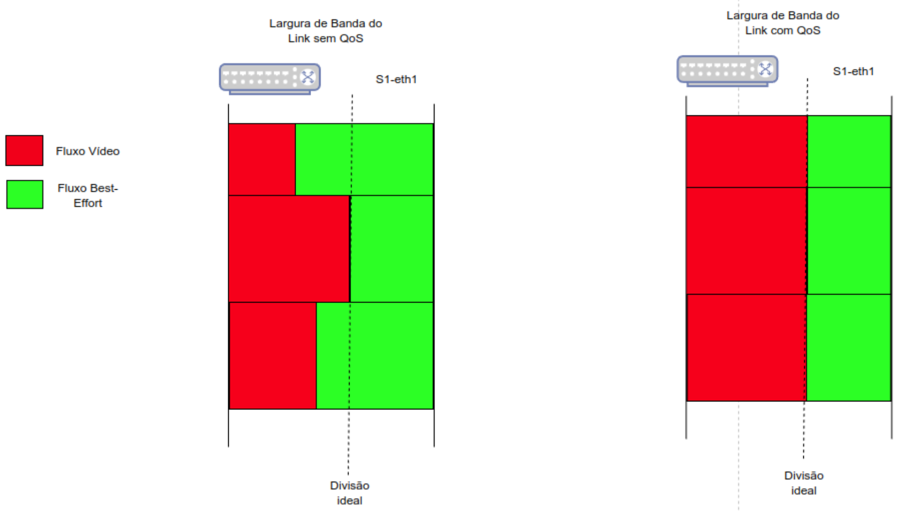

# Laboratório: Gerenciamento e Priorização de Tráfego em Redes SDN OpenFlow


**Autor:** Nilton J. Mocelin Jr.

*Orientador* Adriano Fiorese.

*Universidade do Estado de Santa Catarina (UDESC)*  
*Data: Novembro de 2026*
*Email: nilton.junior@edu.udesc.br

---

## Objetivos

1. Configurar um switch ovs.
2. Entender interfaces de linha de comando ovs (OpenFlow 1.3).
3. Criar regras de fluxos.
4. Gerenciar switch ovs.
5. Configurar regras de priorização de tráfego.

Neste laboratório, os alunos irão simular um AS, com suas próprias políticas de encaminhamento de pacotes. Cada estudante terá um a rede com clientes que acessam o serviço de streaming de video de um servidor, que está em outra rede, fora do seu domínio administrativo. Em determinado momento, fluxos UDP gananciosos surgem para degradar o serviço. O link é ocupado por fluxos que competem por recursos entre si, porém alguns fluxos podem ser considerados mais prioritários que outros, como mostra o monitoramento de um enlace na Figura abaixo.


  
*Figura 2: Disputa por Recursos de Rede.*


O link até o AS do aluno é um gargalo de comunicação e precisa ser gerenciado. A primeira etapa compreende analisar a arquitetura SDN OpenFlow. Depois, vamos simular um cenário sem congestionamento e um com congestionamento. Neste laboratório, dois serviços são fornecidos pelo servidor aos hosts, streaming de video e background. Vamos utilizar a ferramenta sFlow, compatível com OVS, para entender o tipo de tráfego que causa o congestionamento. Depois, vamos criar regras para limitar o tráfego background para priorizar o tráfego do serviço de streaming.  Por fim, vamos analisar um orquestrador automatizado, que faz a analise e cria regras para limitar o fluxo sem intervenção do administrador. 

Neste experimento, iremos utilizar o provedor de nuvem CloudLab, mediante disponibilidade de serviço. Cada aluno deve ter acesso a um switch e um host (administrador/controlador) para explorarem as atividades do laboratório.


## CloudLab
CloudLab é um serviço provedor de nuvem que fornece máquinas virtuais fisicamente distribuídas ao longo dos Estados Unidos. 

  
*Figura 3: CloudLab.*


* Topologia do laboratório
  
*Figura 4: Topologia.*


* Tabela endereçamento

|Domínio|Host|IP H to S|IP S to S|
|---|---|---|---|
|h1|192.168.1.2|192.168.1.1|192.168.1.3|
|h2|192.168.2.2|192.168.2.1|192.168.2.3|
|h3|192.168.3.2|192.168.3.1|192.168.3.3|
|h4|192.168.4.2|192.168.4.1|192.168.4.3|
|h5|192.168.5.2|192.168.5.1|192.168.5.3|
|h6|192.168.6.2|192.168.6.1|192.168.6.3|
|h7|192.168.7.2|192.168.7.1|192.168.7.3|
|h8|192.168.8.2|192.168.8.1|192.168.8.3|
|h9|192.168.9.2|192.168.9.1|192.168.9.3|


<!--   -->
<!-- ou  -->

## Inicio do Lab

Todos os códigos utilizados podem ser encontrados no link: \url{https://github.com/NiltonMocelin/lab_phd}. 

A topologia está escrita no arquivo profile.xml.
Cada dispositivo (switch e host) é inicializado executando o script correspondente de setup/. No entanto, para contextos genéricos, descrevemos nesse documento os passos principais para a configuração de hosts e switches, permitindo que você possa configurar os dispositivos de forma independente, em mininet por exemplo.


Primeiro, clone o repositório para ter acesso a chave privada que será usada para acessar o CloudLab via SSH. Encontre o diretório das chaves, ajuste as permissões e copie para pasta .ssh/ do computador (seu):

```bash
git clone https://github.com/NiltonMocelin/lab_phd_.git
cd lab_phd/chave_lab
cp chave_lab ~/.ssh/
chmod 600 ~/.ssh/chave_lab
```

Será dado um par de endereços IP para cada aluno, um para o switch e um para o host. Com isso, já é possível acessar a máquina via SSH:

```bash
ssh -i ~/.ssh/chave_lab niltonm@ip-do-cloudlab
```


* Ao subir a topologia, cada host e switch executou (ex host1): 
```bash
cd /local && git clone https://github.com/NiltonMocelin/lab_phd.git && cd lab_phd && bash setup/1host_setup.sh
```

## Configuração dos Switches
Os Switches inicializam como máquinas convencionais, com múltiplas interfaces conectando hosts entre si (ou a outro switch). Por isso, vamos configurar-los:

1. Conectar ao switch usando tunel SSH.
```bash
ssh -i ~/.ssh/chave_lab niltonm@ip-do-cloudlab
```
2. Instalar as dependência:
Obs: OpenFlow13 é necessário para criar meters, porém, após definir, todos os comandos ovs precisam usar a flag -OOpenFlow13.

```bash
echo "Instalando dependencias"
sudo apt-get update
sudo apt-get install -y openvswitch-switch
sudo systemctl enable --now openvswitch-switch
```

3. Criando o switch e configurando as portas manualmente:
```bash
echo "Criando o switch OVS"
sudo ovs-vsctl add-br switch1
sudo ovs-vsctl set bridge switch1 protocols=OpenFlow13
sudo ovs-vsctl show

sudo ovs-vsctl set bridge switch1 other-config:datapath-id=0000000000000001
echo "substituir 192.168.10.2 pelo ip do host"
sudo ovs-vsctl set-controller switch1 tcp:192.168.10.2:6653 
sudo ovs-vsctl set Bridge switch1 fail-mode=secure

echo "Listar e adicionar portas ao switch - com nome referenciável nas ações (ex:1)"
ip a
sudo ovs-vsctl add-port switch1 eno2 -- set interface eno2 ofport_request=1

echo "listar o mapeamento de portas (para usar nas ações)"
sudo ovs-vsctl -- --columns=name,ofport list Interface

echo Limpar regras existentes e definir o encaminhamento padrão
sudo ovs-ofctl del-flows -OOpenFlow13 switch1
```

4. Configurando o monitor de fluxos sFlow:
```bash
sudo ovs-vsctl -- --id=@s create sflow agent=$HINTERFACE targets="[\"$HIP:6343\"]" sampling=64 poll=10 -- set bridge switch1 sflow=@s
```

## Configuração Hosts

1. Acessar host via ssh:
```bash
ssh -i ~/.ssh/chave_lab niltonm@ip-do-cloudlab
```

2. Garantir que a tabela ARP não expire e não envie ARP request para o switch (pois ele não vai responder):
```bash
echo "Aumentar a validade das entradas da tabela ARP para 1h"
sudo sysctl -w net.ipv4.neigh.default.base_reachable_time_ms=3600000
sudo arp -s $IP_GATEWAY $MAC_GATEWAY
```

2. Configurar endereços MAC simplificados (mais fáceis para criar as regras)
```bash
echo "Configurar endereço MAC simplificado"
INTERFACE=$(ip -o addr show | awk '/inet 192\.168\./ {print $2; exit}')
sudo ip link set dev "$INTERFACE" down
sleep 1
sudo ip link set dev $INTERFACE address 00:00:00:00:01:01
sudo ip link set dev $INTERFACE up
```

2. Instalar OVS, apenas ferramentas de gerência do OVS (openvswitch-common ou ovs-ofctl) para conseguir enviar os comandos via linha de comando:
```bash
sudo apt-get update
sudo apt-get install -y openvswitch-common
sudo apt-get install iperf3
```

Inicie o servidor iperf, que será usado para simular a aplicação background. No iperf, o servidor apenas recebe os pacotes e mede, é o cliente que gera e envia os pacotes.
```bash
nohup iperf3 -s -u &
```


## Entendendo OVSDB e CLI
- documentação OpenFlow1.3
- conhecer os campos possíveis de modificacao de cada switch
- interface que faz essas modificacoes

No Open vSwitch (OVS), a administração divide-se entre a configuração estrutural da infraestrutura (via OVSDB com ovs-vsctl), inspeção de estado (com ovs-appctl) e o controle programático de pacotes em tempo de execução via OpenFlow 1.3 (ovs-ofctl).

[Link documentação OpenFlow1.3](https://opennetworking.org/wp-content/uploads/2013/04/openflow-spec-v1.3.1.pdf)

Alguns comandos uteis da interface cli ovs:

| Categoria / Ferramenta | Campo / Parâmetro | Explicação | Comando Exemplo |
| --- | --- | --- | --- |
| **OVSDB** (`ovs-vsctl`) | `protocols` (Bridge) | Define as versões do protocolo OpenFlow ativas no bridge (essencial para ativar o OpenFlow 1.3). | `ovs-vsctl set bridge br0 protocols=OpenFlow13` |
| **OVSDB** (`ovs-vsctl`) | `controller` (Bridge) | Configura o endereço IP, porta e canal de conexão com o controlador SDN externo. | `ovs-vsctl set-controller br0 tcp:192.168.1.10:6653` |
| **OVSDB** (`ovs-vsctl`) | `tag` (Port) | Atribui uma VLAN de acesso estática (Access Port) a uma interface específica do switch. | `ovs-vsctl set port vnet0 tag=100` |
| **OVSDB** (`ovs-vsctl`) | `ingress_policing_rate` (Interface) | Configura o limite de taxa de entrada (*rate limiting* / *traffic policing*) em Kbps na interface. | `ovs-vsctl set interface vnet0 ingress_policing_rate=10000` |
| **OpenFlow 1.3** (`ovs-ofctl`) | `eth_src` / `eth_dst` (`set_field`) | Modifica o endereço MAC de origem ou destino de pacotes correspondidos na regra de fluxo. | `ovs-ofctl add-flow br0 "priority=100,actions=set_field:00:11:22:33:44:55->eth_dst,1"` |
| **OpenFlow 1.3** (`ovs-ofctl`) | `ipv4_src` / `ipv4_dst` (`set_field`) | Modifica o endereço IP de origem ou destino do pacote (comum em cenários de NAT/Redirecionamento). | `ovs-ofctl add-flow br0 "ip,actions=set_field:10.0.0.100->ipv4_dst,1"` |
| **OpenFlow 1.3** (`ovs-ofctl`) | `vlan_vid` (`set_field`) | Altera, adiciona (`push_vlan`) ou remove (`pop_vlan`) tags VLAN diretamente via fluxo OpenFlow 1.3. | `ovs-ofctl add-flow br0 "actions=push_vlan:0x8100,set_field:200->vlan_vid,1"` |
| **OpenFlow 1.3** (`ovs-ofctl`) | `tcp_src` / `tcp_dst` (`set_field`) | Modifica a porta TCP de origem ou destino do pacote para redirecionamento de serviços (ex: proxy transparente). | `ovs-ofctl add-flow br0 "tcp,actions=set_field:8080->tcp_dst,1"` |
| **OVS AppCtl** (`ovs-appctl`) | `fdb/show` | Exibe a tabela de encaminhamento dinâmico (MAC Learning) do bridge. | `ovs-appctl fdb/show br0` |


A tabela a seguir apresenta os comandos do `ovs-ofctl` para criação de regras de fluxo com correspondências (*match*) de IP e TCP/UDP, encaminhamento para filas (*queues*), criação de medidores (*meters*) no OpenFlow 1.3 e associação de fluxos a esses medidores:

| Categoria / Operação | Campos de Match / Parâmetros | Descrição do Comportamento | Comando Exemplo (`ovs-ofctl`) |
| --- | --- | --- | --- |
| **Match IP** | `ip`, `nw_src`, `nw_dst` | Corresponde pacotes IPv4 com base no endereço IP de origem (`nw_src`) ou de destino (`nw_dst`). | `ovs-ofctl add-flow br0 "priority=100,ip,nw_src=192.168.1.10,nw_dst=10.0.0.5,actions=1"` |
| **Match TCP / UDP** | `tcp` / `udp`, `tp_src`, `tp_dst` | Corresponde o protocolo de camada 4 e as portas específicas de origem (`tp_src`) ou de destino (`tp_dst`). | `ovs-ofctl add-flow br0 "priority=100,tcp,tp_dst=80,actions=1"` |
| **Encaminhamento para Filas (Queues)** | `enqueue:porta:queue_id` | Direciona o tráfego correspondido para uma fila de QoS específica configurada na interface de saída. | `ovs-ofctl add-flow br0 "priority=100,ip,nw_dst=10.0.0.5,actions=enqueue:1:1"` |
| **Criação de Meter (OpenFlow 1.3)** | `add-meter` (`kbps`/`pktps`, `bands`) | Cria um objeto *meter* no switch para policiamento de banda com taxa limite e ação de descarte (`drop`). | `ovs-ofctl -O OpenFlow13 add-meter br0 "meter=1,kbps,bands=type=drop,rate=1000"` |
| **Regra de Fluxo com Meter** | `actions=meter:id,...` | Vincula o tráfego de um fluxo específico ao *meter* criado para sofrer limitação de taxa. | `ovs-ofctl -O OpenFlow13 add-flow br0 "priority=100,tcp,tp_dst=443,actions=meter:1,1"` |


## Teste de Alcançabilidade

* (exemplo) Dentro do host 1. 
1. Criar regras para alcançar o servidor
```bash
sudo ovs-ofctl add-flow tcp:192.168.1.1:6653 "priority=100,ip,nw_dst=192.168.1.2,actions=set_field:eth_dst->$HMAC,output:1"
sudo ovs-ofctl add-flow tcp:192.168.1.1:6653 "priority=10,ip,nw_dst=192.168.0.0/16,actions=output:2"
```

2. Alcançabilidade (dentro de host1):
```bash
ping 192.168.10.2
```

2. (dentro da sua máquina) Teste de acesso ao serviço de streaming. Redirecionamento streaming para tunel SSH.
```bash
ssh -L 8888:<ip_servidor>:8888 usuario@<ip_do_host>
echo "acesse no navegador local http://localhost:8888/stream/"
```

## Teste de degradação de QoE/QoS

* servidor passa a enviar trafego background para todos os hosts.
```bash
iperf3 -c -u -b 18M
```

- Acessar o host: Analisar qual fluxo consome banda de forma desproporcional usando sFlow.
0. Abrir outro terminal em host1

1. (host1) Executar o cliente sFlow (cliente_sflow.py) 
```bash
python3 cliente_sflow.py
```

2. Analisar os fluxos recebidos no switch (log do cliente_sflow.py).

3. Determinar qual fluxo consome mais banda de forma desproporcional.


## Priorização de tráfego

Após analisar qual o fluxo consome mais banda de forma desproporcional.
1. Priorizar tráfego de streaming. Meter/Fila/Roteamento ? -> Meter:
Criar meter para fluxo background
```bash
sudo ovs-ofctl -OOpenFlow13 add-meter tcp:192.168.1.1:6653 "meter=1,kbps,band=type=drop,rate=500"
sudo ovs-ofctl -OOpenFlow13 add-flow tcp:192.168.1.1:6653 "priority=100,udp,nw_src=192.168.10.2,tp_src=5555,actions=meter:1,2"
```

2. Observar a QoS/QoE, em host1, acessar o streaming novamente.
```bash
ssh -L 8888:<ip_servidor>:8888 usuario@<ip_do_host>
echo "acesse no navegador local http://localhost:8888/stream/"
```

3. Verificar os contadores meter.
```bash
sudo ovs-ofctl -OOpenFlow13 dump-meters tcp:192.168.10.1:6653
```

4. Verificar com iftop
```bash
sudo iftop -i <interface>
```

## Automatizar processo

* Analisar o código do orquestrador_automatizado.py